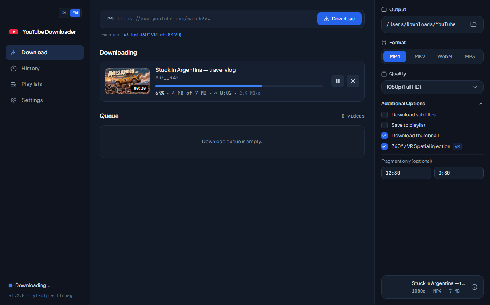

# YouTube & 360° VR Downloader

**English** | [Русский](README.ru.md)

A YouTube video downloader that can grab just the clip you need by timestamp, with no need to download the whole video and trim it afterwards.

## Why

Most downloaders fetch the entire video, even if you only need 30 seconds of a two-hour stream. Here you just set the start time and duration, and only that segment is downloaded.

## Features

- Formats: MP4, MKV, WebM, or audio-only MP3
- Quality up to 8K, with 360° and VR video support
- Clip download: start time + duration
- Playlists: load a list, check the videos you want, and they download one by one
- Single EXE file, no installation required

## How to use

1. Download `YouTube_VR_Downloader_v1.2.exe` from [Releases](../../releases)
2. Run the program
3. Paste a video or playlist link
4. Choose format and quality
5. Optionally set the clip start time and duration
6. Click "Download"

## System requirements

- Windows 10 or 11 (64-bit) with Microsoft Edge WebView2 Runtime (preinstalled on Windows 11 and up-to-date Windows 10)

## Screenshots

## Building from source

Run `2_BUILD_SINGLE_EXE_v1.2.bat` (requires Python with *Add to PATH*). The result is `release\YouTube_VR_Downloader_v1.2.exe`. Other launch options are described in [`INSTRUCTIONS_v1.2.txt`](INSTRUCTIONS_v1.2.txt).

## Acknowledgements

This program is a graphical front end built on top of these open-source projects:

- [yt-dlp](https://github.com/yt-dlp/yt-dlp) — fetches video information, formats and playlists from YouTube and downloads the streams
- [FFmpeg](https://ffmpeg.org/) — merges video and audio, cuts clips and converts audio; the EXE bundles an FFmpeg build licensed under the [GPL](https://ffmpeg.org/legal.html)
- [pywebview](https://github.com/r0x0r/pywebview) — the desktop window around the interface
- [React](https://react.dev/), [Tailwind CSS](https://tailwindcss.com/) and [Lucide](https://lucide.dev/) — the interface

## Disclaimer

This tool is intended for downloading content you have the rights to, or for personal use in accordance with YouTube's Terms of Service and the laws of your country.

## License

[MIT](LICENSE) — for the code in this repository. Bundled third-party components (yt-dlp, FFmpeg and others) are distributed under their own licenses.

## Support

If the app is useful to you, you can support it on [Boosty](https://boosty.to/youtube_vr_downloader/posts/30ce76d3-3900-44d9-8233-456b448dd572).
